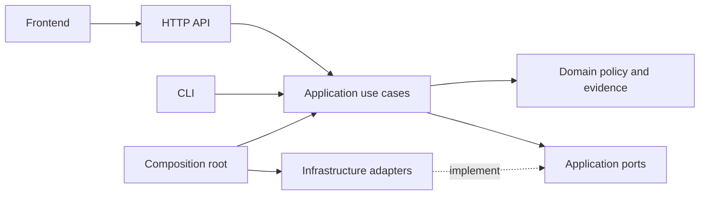

# MigrateLens architecture

The current code is a local reference foundation. The organization is designed to support production development; production readiness is not established.

## Repository ownership

```text
MigrateLens/
├── backend/
│   ├── pyproject.toml              Python application and tooling dependencies
│   ├── requirements.lock          Exact installed Python closure; platform limits recorded
│   ├── src/
│   │   ├── api/                   FastAPI factory, HTTP routing and transport validation
│   │   ├── application/           Fixture use case and adapter protocols
│   │   ├── domain/                Strict contracts, policy and acceptance verdicts
│   │   ├── infrastructure/        Concrete I/O implementations
│   │   │   ├── analysis/          Node analyzer transport
│   │   │   ├── contracts/         Restricted OpenAPI fixture detector
│   │   │   ├── execution/         Local fictional runner, no sandbox claim
│   │   │   ├── fixtures/          Actual synthetic HTTP provider
│   │   │   ├── storage/           Immutable local evidence export
│   │   │   └── verification/      External behavior harness
│   │   ├── config/                Settings validation and repository paths
│   │   ├── cli/                   Command-line entrypoint
│   │   └── bootstrap.py           Concrete dependency wiring
│   ├── analyzer-ts/               Node workspace; ts-morph discovery and recipes
│   └── tests/                     Unit, adapter integration and real-provider gates
├── frontend/
│   ├── src/app/                   Next.js routes, layouts and page states
│   ├── src/features/              Feature-level components
│   └── src/shared/api/            API transport and generated types
├── infra/                         Environment, container and deployment ownership
├── contracts/                     Generated JSON schemas and control API OpenAPI
├── fixtures/                      Fictional consumer and approved mapping inputs
├── scripts/                       Bootstrap helpers, schema export, local supervision
├── docs/                          ADRs, threat model, evidence and progress
├── benchmarks/                    Future evaluation manifests (not implemented)
├── Makefile                       Stable local developer commands
├── package.json                   Workspace orchestration
└── pnpm-workspace.yaml            Frontend and analyzer workspace membership
```

## Dependency rules



1. Domain imports no HTTP framework, database, runner, storage or application code.
2. Application imports domain and abstract ports; it performs no network or subprocess I/O.
3. Infrastructure implements ports and owns concrete third-party APIs.
4. Entry points validate transport input and invoke use cases. They do not duplicate verdict logic.
5. `bootstrap.py` connects real adapters. Tests can supply clearly identified doubles; live evidence cannot silently substitute them.
6. API schemas and generated frontend types have a single canonical source. Run `make schemas` after changes.
7. Tenant context, approved permissions and budget reservations must become explicit use-case inputs before Phase 2 exposes customer operations.

## Planned process roles

| Role | Runtime | Authority | Current state |
|---|---|---|---|
| Frontend | Next.js | Presentation and authorized API requests | Minimal connection shell |
| Control | FastAPI | Identity, policy, plans, metadata and dispatch | Health/config foundation |
| Workflow worker | Temporal Python | Bounded activity scheduling and recovery | Not implemented |
| Analyzer | Node / ts-morph | Registered source analysis and bounded recipes | Fictional adapter implemented |
| Executor | Dedicated isolated runtime for pilot | Approved code execution only | Host fixture adapter only |
| Verifier controller | Trusted backend process | Frozen checks and deterministic verdicts | Fixture harness implemented; HTTP gate blocked |
| Publisher | Separate trusted backend process | Authorized draft branch/PR operations | Not implemented |

PostgreSQL, Temporal and S3-compatible storage are required future infrastructure. Local evidence files are explicitly a fixture export, not a substitute for tenant-aware persistence. No extra databases or service teams are introduced.
