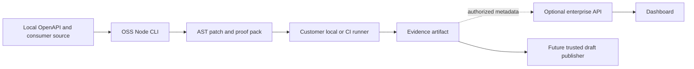

# MigrateLens architecture

ADR 0004 makes `oss/` the primary V1 product and the backend an optional enterprise control plane. The OSS proof loop runs locally or in customer CI. Production readiness is not established.

## Repository ownership

```text
MigrateLens/
├── oss/                           Standalone TypeScript CLI, AST recipes, mock proof and evidence
├── backend/
│   ├── pyproject.toml              Python application and tooling dependencies
│   ├── requirements.lock          Exact installed Python closure; platform limits recorded
│   ├── src/
│   │   ├── api/                   FastAPI factory, HTTP routing and transport validation
│   │   ├── application/           Fixture use case and adapter protocols
│   │   ├── domain/                Strict contracts, policy and acceptance verdicts
│   │   ├── infrastructure/        Concrete I/O implementations
│   │   │   ├── analysis/          Node analyzer transport
│   │   │   ├── contracts/         Restricted OpenAPI fixture detector
│   │   │   ├── execution/         Local fictional runner, no sandbox claim
│   │   │   ├── fixtures/          Actual synthetic HTTP provider
│   │   │   ├── security/          Reviewed fixture admission, not OS isolation
│   │   │   ├── storage/           Immutable local evidence export
│   │   │   └── verification/      External behavior harness
│   │   ├── config/                Settings validation and repository paths
│   │   ├── cli/                   Command-line entrypoint
│   │   └── bootstrap.py           Concrete dependency wiring
│   ├── analyzer-ts/               Node workspace; ts-morph discovery and recipes
│   └── tests/                     Unit, adapter integration and real-provider gates
├── frontend/
│   ├── src/app/                   Next.js routes, layouts and page states
│   ├── src/features/              Feature-level components
│   └── src/shared/api/            API transport and generated types
├── infra/                         Environment, container and deployment ownership
├── contracts/                     Generated JSON schemas and control API OpenAPI
├── fixtures/                      Fictional consumer and approved mapping inputs
├── scripts/                       Bootstrap helpers, schema export, local supervision
├── docs/                          ADRs, threat model, evidence and progress
├── Makefile                       Stable local developer commands
├── package.json                   Workspace orchestration
└── pnpm-workspace.yaml            OSS, frontend and analyzer workspace membership
```

Historical and real pilot benchmark manifests are planned after the customer CI proof loop; no benchmark directory or real comparison results exist yet.

## Dependency rules

`oss/` imports Node/TypeScript libraries only. It has no runtime dependency on `backend/`, `frontend/`, PostgreSQL, Temporal, S3 or model/GitHub credentials. The Python fixture runner remains a historical reference and does not define the new OSS trust boundary. See [OSS boundary](oss-boundary.md).



1. OSS scan/plan/patch does not execute consumer code; prove/verify runs only in the caller's environment.
2. OSS contract, recipe, proof and CLI modules have no backend or enterprise service imports.
3. The optional backend retains domain/application/infrastructure dependency inversion and the `bootstrap.py` composition root.
4. The publisher is separate from execution and cannot accept an unsigned uploaded manifest as a verified CI result.
5. Tenant and repository authorization are required before the enterprise API exposes metadata or policy operations.

## Planned process roles

| Role | Runtime | Authority | Current state |
|---|---|---|---|
| OSS CLI | Node / ts-morph | Local detection, bounded patch and proof generation | Fictional standalone path implemented |
| Customer CI | Customer-owned runner | Executes generated checks under customer policy | Local proof tested; external CI unverified |
| Control | FastAPI | Optional metadata, policy, RBAC and audit | Partial source; live database gate open |
| Frontend | Next.js | Optional enterprise review | Minimal connection shell |
| Publisher | Separate trusted integration | Authorized draft branch/PR only | Not implemented |
| Campaign worker | Postgres outbox initially | Optional cross-repository orchestration | Deferred |

PostgreSQL and S3-compatible storage are optional enterprise infrastructure. Temporal is deferred until cross-repository orchestration warrants it. The OSS core writes local/CI proof artifacts without these services. No extra databases or service teams are introduced.
