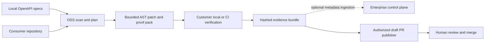

# OSS core and optional enterprise boundary

Updated 2026-10-27. [ADR 0004](decisions/0004-decentralized-gitops.md) governs new V1 implementation.

## What runs where

The first OSS workspace is `oss/`. It has no import or runtime dependency on `backend/`, `frontend/`, PostgreSQL, Temporal, S3, model APIs or GitHub credentials. It may use checked-in fictional fixture inputs. The backend remains optional and cannot claim verification based solely on evidence uploaded by an untrusted client.

## V1 permission and evidence rules

- `scan`, `plan` and `patch` read local inputs and do not execute consumer code.
- `prove` and `verify` execute generated checks only in the caller's local/CI environment. Customer CI must decide what secrets and network access are present. The OSS package is not an isolation boundary.
- `publish` is disabled until a separate GitHub publisher verifies installation scope, current branch/commit, exact proof identity and human approval. It creates draft PRs only.
- Evidence hashes bind bytes and tool versions. They do not authenticate the runner. CI origin and repository commit must be checked before enterprise ingestion or PR claims.
- An unsupported or ambiguous case yields a diagnostic with an empty patch and no verified claim.

## Current gap

The existing Python fixture workflow executed the fictional provider on a host runner and produced historical evidence. A standalone TypeScript OSS path and customer CI proof-pack acceptance are the immediate implementation focus. The optional control plane already has partial persistence/auth source but no live database or workflow gate.
